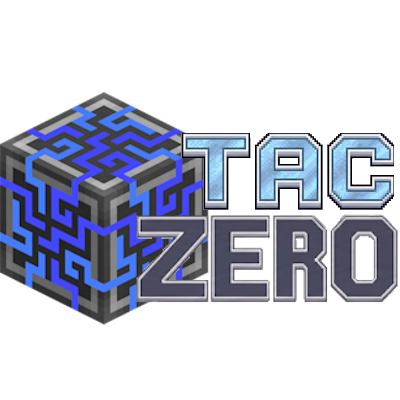

<p align="center">
      
</p>
<h1 align="center">Applied TaCZ</h1>
<p align="center">
    <a href="https://www.curseforge.com/minecraft/mc-mods/applied-tacz" target="_blank">
      
    </a>
    <a href="https://modrinth.com/mod/applied-tacz" target="_blank">
      
    </a>
  
</p>
AppliedTaCZ is mod that integrates **Timeless and Classics Zero (TaCZ)** workbenches with **Applied Energistics 2 (AE2)**.

It adds AE-Support versions of TaCZ workbenches so you can view crafting ingredients from both the player inventory and the ME network, then consume them directly while crafting.

The 1.20.1 Forge and 1.21.1 NeoForge builds target **official TaCZ 1.2.0**. The official
NeoForge TaCZ build is currently marked beta; the former unofficial NeoForge port is no longer supported.

## Feature

- AE-Support versions of TaCZ workbenches
- Combined ingredient counts from player inventory and AE2 network
- Crafting that consumes player inventory first, then ME network storage
- Dedicated and universal molecular assemblers for automatic TaCZ crafting with AE2 processing patterns
- A dedicated TaCZ pattern encoding terminal with workbench tabs and JEI recipe transfer

## TaCZ Pattern Encoding Terminal

Combine an **AE2 Pattern Encoding Terminal + TaCZ Gun Smith Table** in a crafting grid to make
`appliedtacz:tacz_pattern_encoding_terminal`, then attach it to an ME cable like an AE2 terminal.
The upper section retains the network inventory and crafting requests. Workbench tabs on the right
select from loaded TaCZ workbenches, including gunpack workbenches; scroll the tabs or use their arrows
when more than three are available.

The left toolbar's layout button switches **Wide (13 ME columns)** and **Compact (9 ME columns)**.
Compact centers the nine-column grid inside the same-width window; recipe rows, ingredient slots,
pattern slots and the player inventory do not move. Both modes retain AE2's height-dependent row count.
The selection persists in `appliedtacz-client.toml` under `[patternTerminal] compactLayout` (default `false`).
A [GUI mockup](design/pattern-terminal/wide-compact-mockup.png) illustrates the two modes; it is not an in-game screenshot.

The lower left shows three wide recipe rows with an independent scrollbar. Selecting a recipe fills
the right-hand 3 × 3 ingredient preview; its scrollbar covers up to 81 ingredient entries. Click an
ingredient to cycle its accepted items. The selected concrete item and the recipe's full required amount
are encoded, including quantities above a stack. A `+` marks an ingredient craftable by the connected ME network.

Insert blank patterns in the upper pattern slot, press the downward encode button and take the encoded
pattern from the lower slot. Encoding consumes exactly one blank pattern and no recipe ingredients.
An occupied result slot is never overwritten. Patterns are standard AE2 processing patterns accepted
by the existing TaCZ assemblers; tag alternatives are not dynamically interchangeable in a processing pattern.
The lower pattern slot hides its number normally; hold Shift to see the encoded recipe's output quantity.
Put an encoded pattern back into that slot (or shift-click it from your inventory) to view its matching
workbench, recipe and encoded ingredient choices without consuming a blank pattern. This also works
when reopening a terminal with a pattern still in the slot.
Restoration expects one encoded input entry per recipe ingredient; externally merged or split inputs
are not restored. Unmatched patterns remain removable and do not display a stale recipe.
Recipes exceeding 81 ingredients or containing unavailable ingredients remain visible but cannot be encoded.

JEI's recipe-transfer button supports every loaded TaCZ workbench crafting category, including gunpack
workbenches. It selects the source category's exact workbench tab and reveals the matching left-side
recipe row and its ingredients, even when multiple workbenches accept the recipe or it is transferred
again after scrolling away. Ingredients do not need to be in storage. Hovering the transfer button highlights network-craftable ingredients in
AE2 blue. EMI transfer is not implemented. The server validates the current recipe,
workbench filter, ingredient choices and quantities before creating a pattern. Workbench selection does
not add new assembler variants; custom workbench recipes still need a compatible assembler.

## Molecular Assemblers

| Assembler | Floor space | Workbench recipes |
|---|---|---|
| Ammo | 1 × 1 × 1 | Ammo Workbench |
| Attachment | 1 × 1 × 1 | Attachment Workbench |
| Gun | 1 × 1 × 1 | Gun Smith Table |
| Universal (commands only) | 1 × 1 × 1 | All TaCZ workbenches |

Craft a dedicated assembler by combining the original **TaCZ workbench + AE2 Molecular Assembler +
AE2 Pattern Provider**, one of each, in a crafting grid (shapeless). The three original TaCZ workbenches
produce their matching dedicated assembler, retaining the workbench ID and recipe filter.
Universal assemblers, including the single-block `molecular_assembler` alias,
have no crafting recipe and are hidden from creative tabs and JEI/REI/EMI ingredient lists.
Their registered IDs and existing placed blocks remain usable; use commands to obtain them.
Additional gunpack workbenches retain their manual ME workbench upgrades, but do not produce assemblers.

All four variants occupy one block and support connections on all six sides. They share a
single frame model using AE2 Molecular Assembler exterior geometry and UVs around the original graphite inner frame.
The outer beams are partitioned to retain the inner frame without gaps or overlapping volumes.
The exterior directly references the installed AE2 `molecular_assembler` texture; the inner atlas remains original.
AE2's original cutout glass encloses the six faces without a solid center, pedestal or deck.
The original animated prismatic light overlay is reused while online. Asset credits are in
[AE2_ASSET_NOTICE.txt](common/src/main/resources/assets/appliedtacz/AE2_ASSET_NOTICE.txt).
All four blockstates and item models reference the same `appliedtacz:block/tacz_assembler` model.
Workbench-specific assembler items show the corresponding TaCZ workbench's 3D item model as an
8 × 8 badge at the lower right of inventory icons.
The badge follows the stored workbench ID and TaCZ's GUI transforms; universal assemblers have no badge.
Placed assemblers render a miniature
of their TaCZ workbench inside the frame, using TaCZ's loaded model and texture rather than copied assets.
The universal assembler displays the default Gun Smith Table when no workbench ID is assigned.
Their IDs are `tacz_assembler_ammo`, `tacz_assembler_attachment`, `tacz_assembler_gun`, and
`tacz_assembler_universal`. AE2's own assembler is unchanged.
The former multi-block `molecular_assembler_gun`, `molecular_assembler_ammo`,
`molecular_assembler_attachment`, and `molecular_assembler_universal` blocks and items have
been removed, along with their models and multi-block placement logic. Existing worlds containing
these removed IDs are not migrated; recover their contents before updating. Current single-block
normal and Extended assemblers keep their IDs and saved crafting jobs.

Connect the assembler to a powered ME network
with crafting storage and a Crafting CPU. Encode the TaCZ ingredients and the exact result in
a standard AE2 **processing pattern**, then right-click the assembler and insert it into one
of its nine pattern slots. Valid patterns become available for autocrafting requests from an
ME terminal; a separate Pattern Provider is not required.
Every assembler validates the ingredients, quantities, and result. Dedicated assemblers also
validate their workbench's recipe filter and tabs, even when TaCZ's default table filter is disabled.

The five upgrade slots accept AE2 Acceleration Cards. With 0–5 cards, each new craft takes
10/8/6/5/4/2 active server ticks respectively, matching AE2's full-power crafting speed.
Changing cards does not alter a craft already in progress.

Each dedicated compact assembler also has a standalone Extended variant:
`extended_tacz_assembler_gun`, `extended_tacz_assembler_ammo`, and `extended_tacz_assembler_attachment`.
Craft one by surrounding an AE2 Calculation Processor with eight normal assemblers of the same kind.
Extended assemblers share the frame, workbench display, inventory badge, and five upgrade slots, but process
up to eight independent jobs at once, each taking 5/4/3/3/2/1 ticks with 0–5 cards. This follows ExtendedAE's
default full-power per-thread speed and eight-thread capacity without requiring ExtendedAE or reading its config.
Each accepted job consumes its own ingredients and crafting energy; finished outputs retain their own return
destination. A blocked output occupies one job slot without stopping the others. The GUI previews the first
pending output; all jobs survive saves and drop their remaining results exactly once when the machine is broken.
Existing single-job saves migrate automatically; saves containing the new job list are not downgrade-compatible.
Compact workbench displays rotate in place around all three axes,
even while idle, inside a stationary frame. The workbench, rotation, prism and orbital effects are visible only
while the ME network has power, an online channel and has finished booting; the frame and glass stay visible offline.
Their X/Y/Z rotations take 20/30/40 seconds per turn at 20 TPS.
Three pale-cyan orbital arcs and small moving light packets surround the workbench. While crafting, they
smoothly turn orange, brighten, and rotate about 2.4–2.5 times faster; they ease back when crafting stops.
These original, client-only effects fade beyond 16 blocks and disappear at 24 blocks;
they use no copied assets or additional dependencies.
Completed items return to the ME network, where the requesting Crafting CPU receives them.
An external Pattern Provider can still supply processing patterns through an exposed side;
those results return to that provider, including its result-lock handling.
A blocked return keeps the output buffered instead of discarding it. Stored patterns, acceleration cards and
in-progress output survive saves and are dropped when the machine is broken.
Right-click an assembler to open its AE2-style pattern and status screen.
Its title uses `ME <translated TaCZ workbench name> Assembler`. It shows the ME connection, crafting state,
acceleration slots and pending-output item, without raw IDs, return-buffer labels or extra help tooltips.
Jade shows the translated assembler name, ME connection and crafting state.
The output preview is read-only: items return automatically, and this screen does not perform manual crafting.
The existing manual ME workbenches remain available.

Editable compact models and their generation check are in [design/assemblers/compact](design/assemblers/compact/README.md).

## Client Configuration

`config/appliedtacz-client.toml` controls compact assembler visuals separately for each player:

```toml
[assembler]
renderWorkbench = true
rotateWorkbench = true
```

- `renderWorkbench = false` hides the internal TaCZ workbench and its orbital effects, skipping model lookup and rendering.
- `rotateWorkbench = false` keeps the workbench in its default block-facing orientation instead of spinning on X/Y/Z.
  Orbital effects and prismatic lights keep animating; this option has no visible effect when the workbench is hidden.

Both default to `true`. The frame, glass and online prismatic lights are unaffected. The existing online-only
condition still applies, and crafting/server behavior is unchanged. Edit this client file, not the world's server config;
restart the client after editing to ensure the settings are loaded.

## Server Configuration

`appliedtacz-server.toml` provides `gunSmithTable.ingredientCountUpdateIntervalTicks` to control how often watched
gun smith table ingredient counts are recalculated. The default is `10` server ticks and the valid range is `1` to
`20`; lower values update the screen faster while using more server CPU.

## Support Workbench

| Workbench | Base Mod | AE Support |
|-----------|----------|------------|
| Gun Smith Table | TaCZ | ✔️ |
| Ammo Workbench | TaCZ | ✔️ |
| Attachment Workbench | TaCZ | ✔️ |

## License
- code: `GNU GPL 3.0`
- TaCZ assets: `CC BY-NC-ND 4.0` by the TaCZ team
- Adapted AE2 Molecular Assembler outer-frame asset: `CC BY-NC-SA 3.0`; see the asset notice above.
