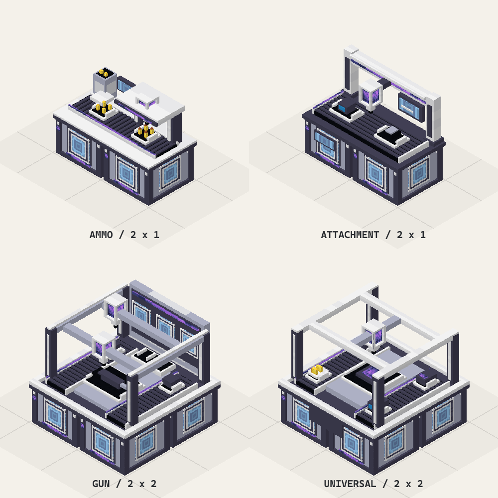
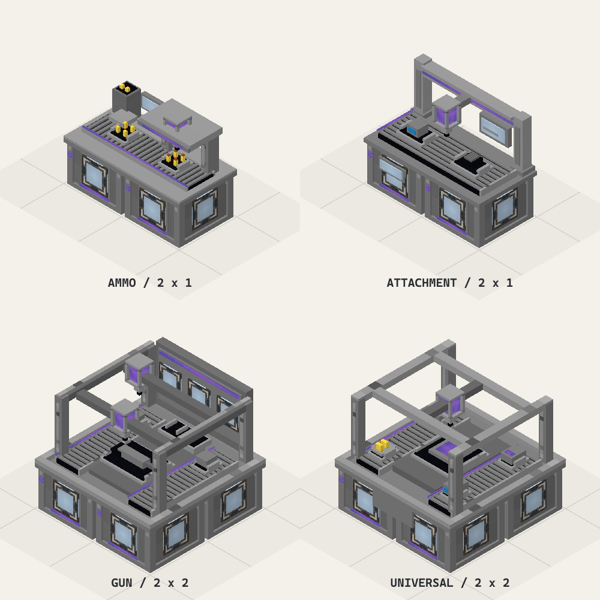

# AppliedTaCZ assembly-line models

The current shared single-block frame is in [compact/](compact/README.md). The larger models below
are retained for older placed assemblers and are not overwritten by the compact generator.

1.21.1:



1.20.1, rendered with the installed AE2 15.4.10 textures:



| Model | Footprint | Visible height | Occupied cells |
|---|---|---|---|
| Ammo press | 2 × 1 | 24 pixels | 2 × 1 × 2 |
| Attachment line | 2 × 1 | 24 pixels | 2 × 1 × 2 |
| Gun assembly cell | 2 × 2 | 28 pixels | 2 × 2 × 2 |
| Universal assembly cell | 2 × 2 | 28 pixels | 2 × 2 × 2 |

`models/` contains the full-size editable **Java Block/Item JSON** models for Blockbench import.
The Forge-specific versions are in `models/1.20.1/`.
Their texture references use Minecraft and AE2 resources; load those resource textures in the editor.
No TaCZ model or texture is copied into these assets.

The AE2 styling uses crafting-unit casing, molecular-assembler frame strips, interface panels,
and fluix cores directly from AE2. Common models use `forge_data` for fullbright faces; the
NeoForge resource-sync task converts that key to `neoforge_data` (NeoForge rejects the old key).
This is a visual effect only, not emitted world light. No new texture dependency is added.
Forge 1.20.1 resolves the same texture IDs to AE2 15's original gray/silver and pale-blue
textures. Its module-local model overrides sample the silver inner assembler rim at x=1,
instead of the dark outer border at x=0. Geometry, sizes and the shared 1.21.1 models are unchanged.
ME cabinet and processor panels are square; other faces center-crop their texture to keep
its proportions. Clipped block cells retain the original face UV region without restarting
or stretching the pattern at a block boundary.

`generate-models.mjs` is the cuboid source. It also creates clipped block-cell models,
all facing/part variants, and scaled inventory models in `common/src/main/resources`.
North is the model front: local X is right/east, Y is up, Z is back/south.
The part index is `y * width * depth + z * width + x`; part 0 is the controller.

From the repository root:

```sh
node design/assemblers/generate-models.mjs
node design/assemblers/generate-models.mjs --check
node design/assemblers/generate-models.mjs --forge-1.20.1
node design/assemblers/generate-models.mjs --forge-1.20.1 --check
```

The check verifies bounds, nonempty occupied cells, lossless cell clipping, proportional
face UVs, clipped UV orientation and scaled item UVs, all 32 state variants per block,
matching geometry across versions, and exact agreement with the checked-in models.
Forge overrides are written to `forge-1.20.1/src/main/resources`; the existing resource
processing order gives module-local models priority over the common models.

`render-preview.mjs` renders the full-size model geometry offline (not an in-game screenshot).
It uses existing `sharp`/`jszip` packages and textures directly from the matching Minecraft
`client-extra.jar` and installed AE2 JAR:

```sh
node design/assemblers/render-preview.mjs <node_modules> <client-extra.jar> <AE2-19-jar>
node design/assemblers/render-preview.mjs <node_modules> <client-extra.jar> <AE2-15-jar> --forge-1.20.1
```

The initial image-generated concept and its prompt are in `2026-09-06/`; that earlier concept
predates the wider ammo press and universal assembler. The JSON models, not the concept
image, are the assets used in game. The casing uses static models; the shared
`AEMolecularAssemblerRenderer` adds a metal ram and sleeve at each model's spindle.
The ram moves while the server-synchronized crafting flag is active, and rests while
offline or waiting for output space. It uses vanilla iron-block geometry and texture.
