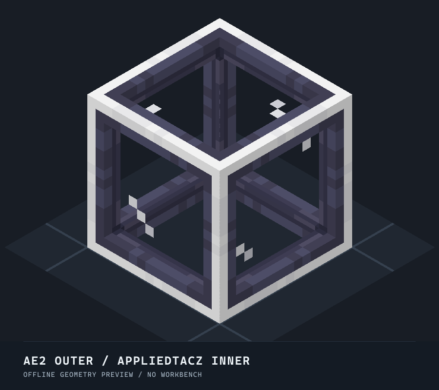
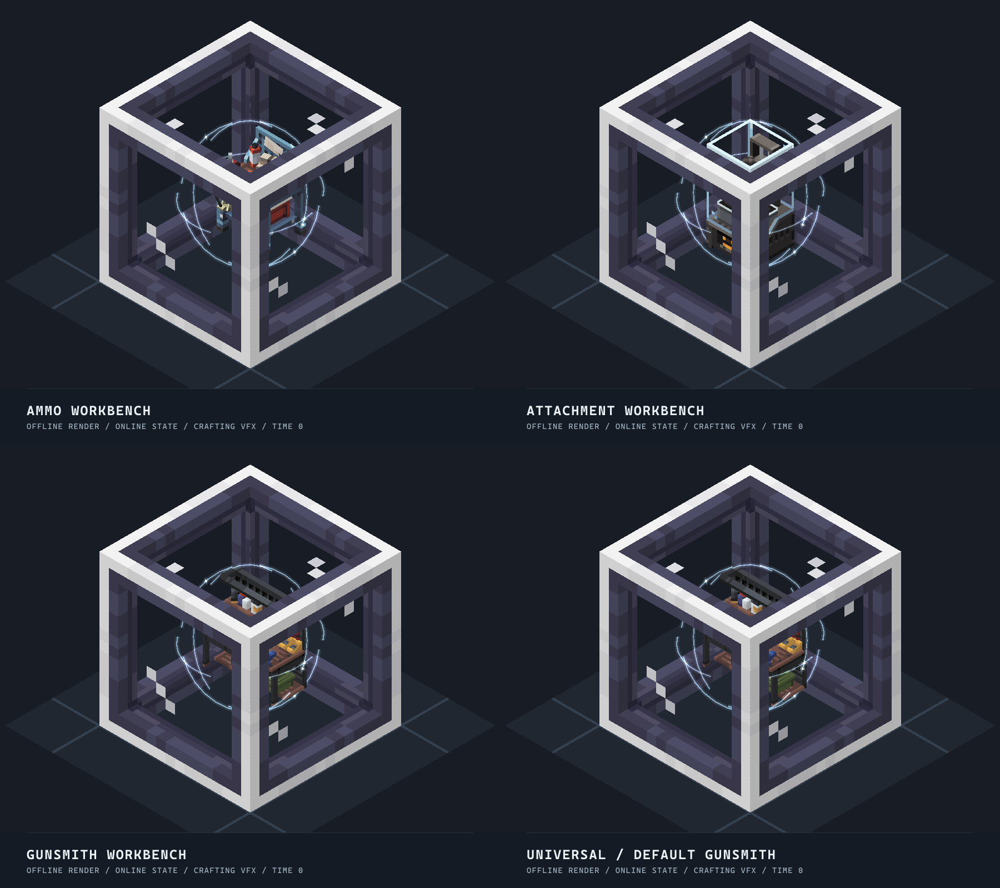

# 단일 블록 TaCZ 어셈블러



일반형 4종은 1×1×1 공통 모델 안에 바깥·안쪽 골조를 빈틈 없이 맞물리게 넣은 외형을 공유합니다.
Extended형 3종은 ExtendedAE가 설치되어 있으면 해당 모드의 Molecular Assembler 모델·텍스처를 직접 참조합니다.
별도의 ExtendedAE 이미지는 포함하지 않으며, 미설치 상태에서는 일반 TaCZ 어셈블러 외형을 사용합니다.
외형만 선택적으로 연동되므로 ExtendedAE는 필수 의존성이 아닙니다.
두 골조가 합쳐져 속이 찬 2픽셀 두께의 모서리 12개를 이루며, 사이에 틈이나 겹치는 부피가 없습니다.
바깥 골조는 AE2 Molecular Assembler 원본 외곽의 좌표·UV를 가져왔고, 안쪽 흑연 골조는 기존 좌표·UV·픽셀을 유지합니다.
`generate-models.mjs`는 AE2 19.2.16의 외곽 빔 12개에서 안쪽 골조 공간을 제외해 맞물리는 32개 조각으로 나눕니다.
원본의 UV 회전·반전·블록 경계 cullface를 유지하며, 중앙의 2~14픽셀 유리 표면도 원본 UV로 적용합니다.
별도 프리즘 조명은 AE2가 등록한 `block/molecular_assembler_lights` 모델과 애니메이션 텍스처를 직접 렌더링합니다.
게임에서는 `ae2:block/molecular_assembler`를 직접 참조합니다. AE2 텍스처 사본을 게임 리소스에 넣지 않습니다.
안쪽 골조는 기존 64×64 독립 아틀라스를 사용합니다. 외부 에셋 출처와 라이선스는
[AE2_ASSET_NOTICE.txt](../../../common/src/main/resources/assets/appliedtacz/AE2_ASSET_NOTICE.txt)에 기록했습니다.
바닥을 포함한 여섯 면에 AE2의 cutout 유리를 적용하고 중앙은 비워둡니다. 받침대·바닥판·배지는 없습니다.
종류별 외곽 색상과 식별 모양은 없으며, 블록 ID·제작 기능만 유지됩니다.
설치한 블록 내부에는 기존 방식대로 TaCZ가 로드한 실제 작업대 모델·텍스처를 축소 렌더링합니다.
TaCZ 원본 모델·텍스처 사본을 배포 리소스에 추가하지 않습니다. 위 미리보기와 Blockbench 파일은 외곽
프레임과 유리만 포함합니다. 아래 작업대 포함 미리보기는 로컬 TaCZ 에셋을 사용한 온라인 상태의 오프라인 렌더이며
게임 스크린샷이 아닙니다. AE2 프리즘 애니메이션은 Minecraft의 실제 등록 모델을 사용하므로 이 정지 미리보기에는 없습니다.
외부 텍스처 미리보기는 AE2 19.2.16 기준입니다. 1.20.1에서는 설치된 AE2 15.4.10의 원본 색상으로 표시됩니다.



| 종류 | 블록 ID | 내부 표시 |
| --- | --- | --- |
| 탄약 | `appliedtacz:tacz_assembler_ammo` | TaCZ 탄약 작업대 |
| 부착물 | `appliedtacz:tacz_assembler_attachment` | TaCZ 부착물 작업대 |
| 총기 | `appliedtacz:tacz_assembler_gun` | TaCZ 총기 작업대 |
| 범용 (명령어 전용) | `appliedtacz:tacz_assembler_universal` | 지정 ID가 없으면 기본 총기 작업대 |

전용 3종은 AE2 분자 조립기·패턴 공급기·원본 TaCZ 작업대를 하나씩 합치는 비정형 제작법을 사용합니다.
범용과 단일 블록 범용 별칭 `molecular_assembler`는 제작법·크리에이티브 탭·JEI/REI/EMI에서 숨깁니다.
현재 1×1 블록의 ID와 저장 데이터는 유지합니다. 예전 대형 `molecular_assembler_<종류>` 4종은 제거했으며
자동 이전하지 않습니다. 기존 대형 조립기의 내용물은 업데이트 전에 회수해야 합니다.
화면·아이템·Jade 이름은 `ME {TaCZ 작업대 번역명} Assembler` 형식이며, 한국어에서는 `ME … 조립기`로 표시합니다.
원시 ID·반환 버퍼 설명·추가 호버 설명은 없애고, 실제 결과물 보관·자동 반환과 확인용 슬롯은 유지합니다.
가속 카드 0~5개에 따라 일반형의 새 제작은 AE2와 같은 10/8/6/5/4/2 활성 서버 틱이 걸리며, 카드도 저장·파괴 드롭됩니다.
전용 3종에는 `extended_tacz_assembler_*` 독립형 상위 버전도 있습니다. 동일 종류의 일반형 8개를 두르고
중앙에 Calculation Processor를 넣어 제작합니다. 최대 8개 작업이 각각 5/4/3/3/2/1틱에 병렬 진행되며,
각 결과의 반환 위치·남은 시간·수량을 따로 저장합니다. 출력이 막힌 작업만 슬롯을 계속 차지합니다.
ExtendedAE의 기본 처리 속도·동시 작업 수를 따르되 해당 모드 의존성이나 설정 연동은 없습니다.

내부 작업대는 블록 방향을 기준으로 X·Y·Z축을 각각 20·30·40초에 한 바퀴씩 회전합니다(20 TPS 기준).
프레임은 고정이며 온라인 상태에서는 대기 중에도 회전합니다. 전원·온라인 채널·네트워크 부팅이 모두 정상일 때만
작업대·회전·프리즘·기존 VFX를 표시합니다. 오프라인에는 프레임과 유리만 남습니다.
부분 틱을 보간하므로 프레임 사이의 움직임도 이어집니다.
클라이언트의 `config/appliedtacz-client.toml`에서 `[assembler]`의 `renderWorkbench=false`로 내부 작업대와
주변 VFX를 숨길 수 있습니다. `rotateWorkbench=false`는 작업대만 기본 배치 방향으로 고정하며,
프리즘과 주변 VFX 애니메이션은 유지합니다. 둘 다 기본값은 `true`이며, 외부 프레임·유리·온라인 프리즘과
서버 자동조합에는 영향을 주지 않습니다. 파일 수정 후 클라이언트를 재시작하면 확실히 적용됩니다.
옅은 청록색 교차 링 3개와 궤도를 따라 이동하는 빛 점이 작업대를 감쌉니다. 제작 중에는 빛 점이
3개에서 6개로 늘고 밝기가 맥동합니다. 링의 회전 주기는 대기 시 240/300/400틱, 제작 시 100/125/160틱이며,
8틱에 걸쳐 가속하고 청록색에서 주황색으로 바뀝니다. 종료 시에도 부드럽게 되돌아갑니다.
대기 중에는 약하게 유지하며 완료 이벤트를 흉내 내는 연출은 없습니다.
16블록부터 효과가 흐려지고 24블록 밖에서는 그리지 않습니다. 최대 720정점(180쿼드)의 클라이언트 전용
도형이며 월드 파티클·새 텍스처·외부 라이브러리를 추가하지 않습니다. OmniSequence는 연출 방향만 참고했습니다.
인벤토리 아이콘 오른쪽 아래에는 해당 작업대의 3D 모델을 8×8 크기로 표시합니다. 범용에는 표시하지 않습니다.
TaCZ 모델의 실제 큐브·본 변환으로 크기를 한 번 측정해 캐시하고, 모델 경계의 중심을 블록 중심에 맞춥니다.
경계 상자의 대각선이 11.5픽셀이 되도록 축소해 어느 방향으로 회전해도 2~14픽셀 내부 공간에 들어오도록 합니다.
리소스 재로딩으로 모델 객체가 교체되면 다시 측정합니다. 특수 건팩의 과도한 큐브 팽창(inflate)은
측정 범위에 포함되지 않으므로, 기본 모델용 여유 공간을 넘으면 별도 조정이 필요할 수 있습니다.
기존 AE2 처리 패턴 기반 자동조합을 사용하고, 전용 종류는 대응하는 작업대 레시피만 허용합니다.
범용 종류는 모든 TaCZ 작업대 레시피를 처리합니다. 자세한 제작법과 사용법은 저장소 README를 참고하세요.

`tacz_assembler.bbmodel`이 현재 게임 적용용 편집 모델이며 `Outer frame`·`Inner frame`·`AE2 glass` 그룹으로 나뉩니다. 게임용 모델은
`common/src/main/resources/assets/appliedtacz/models/block/tacz_assembler.json` 하나이며,
일반형 4종의 블록 상태·아이템 모델이 이 파일을 참조합니다. Extended형 3종은 각 로더의
`models/block/extended_tacz_assembler.json`을 참조합니다. 일반형 내부 텍스처는
`common/src/main/resources/assets/appliedtacz/textures/block/tacz_assembler.png`, 외부 텍스처는 설치된 AE2가 제공합니다.
Blockbench는 두 텍스처를 구분하며 외부 텍스처는 아래 로컬 AE2 소스의 실제 리소스 경로를 참조합니다.
이전 종류별 외곽 모델·편집 파일·미리보기·외곽 아틀라스 사본은 제거했습니다.

게임에 적용하지 않은 외부 프레임 시안 4개는 [variants](variants/README.md)에 별도로 있습니다.
이 시안은 위 4종 어셈블러의 종류별 모델이 아니라, 공통 외형을 선택하기 위한 대안입니다.

생성기와 미리보기에는 로컬 `../fork/Applied-Energistics-2_1_21_1/src/main/resources/assets/ae2`가 필요합니다.
이 소스의 모델과 텍스처는 설치된 AE2 19.2.16 JAR의 동일 에셋과 비교했습니다.
저장소 루트에서 기존 `sharp` 설치가 포함된 `node_modules` 경로를 넘겨 실행합니다:

```sh
node design/assemblers/compact/generate-models.mjs <node_modules>
node design/assemblers/compact/generate-models.mjs <node_modules> --check
node design/assemblers/compact/render-preview.mjs <node_modules>
```

실제 작업대가 포함된 4분할 미리보기는 아래 명령으로 생성합니다. 로컬 TaCZ 에셋을 읽고,
현재 컴파일된 NeoForge 렌더러와 TaCZ 본 변환·정점·UV를 사용합니다. 임시 메시만 시스템 임시 폴더에 저장합니다.
범용은 현재 기본 동작과 동일한 총기 작업대입니다. 제작 중 VFX와 회전 시각 0의 정지 화면이며,
게임 코드가 출력한 정점을 사용합니다. Minecraft 조명·셰이더를 재현한 스크린샷은 아닙니다.

```powershell
& ./design/assemblers/compact/export-workbench-preview.ps1
node design/assemblers/compact/render-preview.mjs <node_modules> "$env:TEMP/appliedtacz-workbench-preview/workbenches-1.21.1.json"
```

생성기는 공통 모델·편집 파일·텍스처와 4개 블록의 참조 파일만 갱신합니다.
구형 대형 설비의 모델·블록 ID·다중 블록 동작은 제거했습니다. 검사 모드는 단일 블록 범위, 텍스처 UV,
UUID, 속이 찬 골조의 빈틈·부피 겹침 여부·면별 재질과 유리를 제외한 6방향 개방부, 원본 유리 UV,
생성 파일 일치 및 외곽 모델 파일이 정확히 하나인지 확인합니다.

## 화면·가속 카드·Jade·제작법 검증 (2026-10-14)

- 두 버전의 `compileJava`, `runData`, `build`를 통과했습니다. `test`는 `NO-SOURCE`이며,
  전용 GameTest 서버에서는 Forge 27개, NeoForge 28개 테스트가 모두 통과했습니다.
- 원본 작업대·분자 조립기·패턴 공급기 제작법, 범용 제작법 부재와 숨김 태그,
  가속 카드 슬롯·저장·회수·실제 제작 시간·결과물 중복 방지를 검사했습니다.
- Jade 등록·번역 키와 화면 리소스 회귀 검사를 통과했습니다. 기존 NeoForge Jade 중복 설정 오류도 수정했습니다.
  두 클라이언트가 Jade 및 리소스 로딩을 오류 없이 완료하고 정상 종료했습니다.
- 최종 JAR의 Jade 번역·숨김 태그 포함 및 범용 제작법 부재를 확인했습니다.
  실제 월드의 GUI/Jade 육안 확인과 JEI/REI/EMI 목록 조작은 미검증입니다. 배포·커밋·푸시는 하지 않았습니다.

## 클라이언트 표시·회전 설정 검증 (2026-10-14)

- 두 로더의 실제 설정 스펙에서 기본값, 독립적인 불리언 4조합, 잘못된 타입의 기본값 교정을 검사했습니다.
  `AssemblerClientConfigCheck.java`를 각 로더의 컴파일 클래스와 클래스패스로 따로 실행했습니다.
- `check-workbench-bounds.ps1`은 NeoForge 바이너리로 표시 조건·회전·VFX·설정 스펙을 검사합니다.
  회전을 끈 작업대의 자세가 네 방향과 전체 반복 구간에서 최초 자세와 같음을 확인했습니다.
- 두 버전 `compileJava`·`build`, Forge GameTest 23개·NeoForge GameTest 25개를 통과했습니다.
  두 클라이언트에서 설정 파일 자동 생성·리소스 로딩·정상 종료를 확인했습니다.
- 실제 월드 육안 확인·실시간 설정 재로딩·배포는 미실행입니다. 에셋 변경이 없어 `runData`는 재실행하지 않았습니다.
  기존 NeoForge Jade 중복 설정 오류와 Forge MEGA Cells의 EMC loot table 파싱 오류는 별도입니다.

## 온라인 표시와 AE2 유리·프리즘 (2026-10-14)

- 기존 전원·온라인·부팅 상태 동기화를 재사용합니다. 공통 렌더러가 오프라인에서 내부 작업대·회전·VFX·프리즘을 생략하며,
  정적인 프레임과 유리는 남습니다. 새 패킷·서버 로직·의존성을 추가하지 않았습니다.
- 기존 44개 프레임 조각은 유지하고 AE2 원본의 6면 유리 표면 하나를 더했습니다. 프리즘은 AE2가 등록한 모델과
  `tripwire` 렌더 레이어를 사용하며, 깊이를 쓰는 반투명 표면이 내부를 가리지 않도록 작업대·VFX 다음에 그립니다.
- 온라인 조건 8조합, 작업대 회전·VFX 경계, 유리 투명 픽셀·원본 강조 픽셀, 모델·시안 생성 재현 검사를 통과했습니다.
  두 버전 `compileJava`·`build`·`runData`, JAR 리소스 일치 검사 및 클라이언트 리소스 로딩·정상 종료를 확인했습니다.
- 실제 월드에서 연결·차단하며 보는 전환과 셰이더팩 조합은 미검증입니다. 클라이언트 렌더링 변경이라 서버·GameTest는
  재실행하지 않았습니다. 기존 NeoForge Jade 중복 설정 오류는 별도로 남아 있습니다. 이번 변경분은 인스턴스에 재배포하지 않았습니다.

## AE2 외부 프레임 적용 (2026-10-13)

- AE2 1.21.1 모델의 외곽 빔 좌표·UV만 가져와 양쪽 버전에 적용했습니다. 내부 프레임 모델·UV·Blockbench
  요소와 독립 아틀라스의 해시가 변경 전과 같습니다. 기존 A–D 시안은 별도로 보존합니다.
- 양쪽 로컬 AE2 모델·텍스처가 해당 버전 설치 JAR의 에셋과 일치함을 확인했습니다. 두 버전 텍스처는
  16×16이며 외곽 2픽셀은 모두 불투명하지만 RGB가 다릅니다. 게임은 각 버전의 원본 텍스처를 참조합니다.
- 생성기·시안 재현 검사, 회전·VFX 경계 검사, 미리보기 검사를 통과했습니다. 별도 UV 검토에서는
  외부 UV 정점 400개 및 노출 단위면 1,248개의 매핑·누락·경계 cullface를 확인했습니다.
- 두 버전 `build`·`runData`와 JAR 모델·텍스처·에셋 고지 해시 검사를 통과했습니다.
- 두 클라이언트의 리소스 로딩을 확인했습니다. 새 모델·텍스처 오류는 없으며 기존 NeoForge Jade 중복 설정 오류는 별도입니다.
- 리소스만 변경해 서버·GameTest는 재실행하지 않았습니다. 실제 월드 육안 확인·Blockbench 앱 직접 열기·
  배포·커밋·푸시는 미실행입니다.

## 프레임 틈 제거 (2026-10-13, AE2 외부 적용 전)

- 2픽셀 골조를 바깥 세라믹·안쪽 흑연으로 분할해 면으로 맞닿도록 했습니다. 44큐브는 두 편집 그룹을
  유지하며 중앙 공간·여섯 면의 개방부·작업대 회전·VFX는 변경하지 않았습니다.
- 모든 큐브를 정수 경계로 제한하고 16³ 공간의 각 셀을 검사해 빈틈·겹침·재질 배치를 확인합니다.
  기존 모델에서 빈틈을 검출했고 수정 후 생성기 검사와 오프라인 미리보기·회전·VFX 경계 검사가 통과했습니다.
- 두 버전 `build`·`runData`, JAR 모델·텍스처 해시 일치와 클라이언트 리소스 로딩을 확인했습니다.
  새 모델 오류는 없으며 기존 NeoForge Jade 중복 설정 오류는 남아 있습니다.
- 리소스만 변경해 서버·GameTest는 재실행하지 않았습니다. 실제 월드 육안 확인·Blockbench 앱 직접 열기·
  배포·커밋·푸시는 하지 않았습니다.

## 이중 프레임 검증 (2026-10-13, 틈 제거 전)

- 한 골조의 면별 색상 구분을 바깥·안쪽 두 골조로 변경했습니다. 공통 모델은 총 24큐브이며,
  Blockbench에서도 두 그룹으로 편집할 수 있습니다. 기존 독립 텍스처와 내부 2~14픽셀 공간을 유지합니다.
- 생성기 `--check`, 작업대 회전·VFX 경계 검사와 실제 작업대 포함 오프라인 미리보기 검사를 통과했습니다.
- 두 버전 `build`·`runData`, JAR 모델·텍스처 해시 일치 및 클라이언트 리소스 로딩을 확인했습니다.
  새 모델 오류는 없었으며 기존 NeoForge Jade 중복 설정 오류는 별도입니다.
- 모델만 변경해 서버·GameTest는 재실행하지 않았습니다. 실제 월드 육안 확인과 Blockbench 앱 직접 열기는
  미실행이며, 배포·커밋·푸시는 하지 않았습니다.

## 내부 VFX (2026-10-13, 이중 프레임 변경 전)

- 교차 링·이동 빛 점·제작 중 밝기 맥동을 공통 렌더러에 추가했습니다. 외곽 모델, 작업대의 XYZ 회전,
  자동조합·저장·서버 동작은 변경하지 않았습니다.
- 효과는 깊이 검사와 색상 전용 쓰기를 사용합니다. 배경을 관통하거나 투명 영역으로 깊이 버퍼를 가리지 않도록 했습니다.
  번짐은 넓고 희미한 도형을 겹친 표현이며 후처리 블룸이나 동적 조명은 추가하지 않습니다.
- `check-workbench-bounds.ps1`의 VFX 검사는 실제 정점 출력의 개수 상한·프레임 내부 범위·포즈 복원·부분 틱·반복 경계·
  제작 상태 밝기·거리 감쇠를 검사합니다. 오프라인 미리보기에도 같은 정점과 가산 합성·가림 검사를 사용합니다.
- 두 버전 `compileJava`·`build` 및 클라이언트 리소스 로딩을 확인했습니다. 정점·미리보기 검사도 통과했으며,
  Gradle `test`는 두 버전 모두 `NO-SOURCE`입니다. 기존 NeoForge Jade 중복 설정 오류는 남아 있습니다.
- 클라이언트 렌더링만 변경해 서버·GameTest·데이터 생성은 재실행하지 않았습니다. 실제 월드 육안 확인,
  대량 설치 성능 측정, 유리·물과의 합성 및 셰이더팩 호환성은 별도 확인이 필요합니다.

## 내부 작업대 회전 (2026-10-13, VFX 추가 전)

- 두 버전이 공유하는 렌더러에 중심 기준 XYZ 회전을 추가했습니다. 외곽 모델·텍스처와 자동조합 로직은 변경하지 않았습니다.
- 게임 시간을 2400틱 반복 구간으로 제한하고 부분 틱을 더해 장기 실행에서도 회전 정밀도를 유지합니다.
- 기존 경계 검사와 실제 TaCZ 정점 내보내기가 게임과 같은 변환을 사용합니다. 회전 중 중심 고정·프레임 내부 여유 공간·
  반복 경계 연속성을 검사하며, 실제 정점은 큐브 팽창을 포함해 반지름 6픽셀 구 안에 들어오는지 확인합니다.
- 두 버전 `compileJava`·`build` 성공 및 클라이언트 리소스 로딩을 확인했습니다. `test`는 두 버전 모두 `NO-SOURCE`이며,
  별도 경계 검사와 두 버전 기본 작업대 정점 검사는 통과했습니다. 기존 NeoForge Jade 오류는 별도입니다.
- 클라이언트 전용 렌더 변환만 변경해 서버·GameTest·데이터 생성은 재실행하지 않았습니다. 실제 월드에서의 회전 육안 확인은 미실행입니다.

## 표면 디테일 검증 (2026-10-13, 내부 회전 변경 전)

- 기존 64×64 텍스처에 바깥 면·안쪽 면용 32×32 도안을 직접 작성했습니다. UV를 블록 면 좌표에 맞춰
  인접 골조의 접합선이 이어지도록 했으며 Blockbench에도 같은 UV를 저장합니다.
- 12큐브·2픽셀 골조·6방향 개방 구조와 작업대 배치는 그대로입니다. 생성기 `--check` 및 미리보기 검사를 통과했습니다.
- 두 버전의 `build`·`runData`, JAR 모델·텍스처 해시 검사와 클라이언트 리소스 로딩을 확인했습니다.
  새 에셋 오류는 없었으며, 기존 NeoForge Jade 중복 설정 오류는 별도입니다. 인게임 육안 확인은 미실행입니다.

## 균일 입방체 골조 검증 (2026-10-13, 표면 디테일 변경 전)

- 원본 Molecular Assembler의 입방체 비율을 참고하되 모델과 텍스처는 직접 작성했습니다.
  12큐브·2픽셀 골조·6방향 개방 검사와 생성기 `--check`를 통과했습니다.
- 실제 TaCZ 작업대 정점(큐브 팽창 포함)이 내부 2~14픽셀 범위에 들어옴을 확인했습니다.
  원래 렌더러와 조합 기능은 변경하지 않았습니다.
- 두 버전의 `build`·`runData`, JAR 모델·텍스처 해시 검사와 클라이언트 리소스 로딩을 확인했습니다.
  새 에셋 오류는 없었으며, 기존 NeoForge Jade 오류는 별도입니다. 인게임 육안 확인은 미실행입니다.

## 개방형 프레임 검증 (2026-10-13, 균일 입방체 변경 전)

- 후면 벽을 제거하고, 매끈한 형태를 유지하면서 회보라색 연결부와 작은 크리스털 포트로 AE2 느낌을 추가했습니다.
  공통 모델은 21큐브이며 작업대 렌더러·자동조합 기능은 변경하지 않았습니다.
- 생성기 `--check`와 작업대 포함 미리보기 검사를 통과했습니다. 개방부 검사는 네 옆면과 윗면에
  벽이 들어오지 않는지 확인하며, 기존 후면 벽도 검출합니다.
- 두 버전의 `build`·`runData`와 JAR 모델·텍스처 해시 검증을 통과했습니다. 두 클라이언트에서 리소스 로딩을
  확인했으며 새 모델 오류는 없었습니다. 기존 NeoForge Jade 오류는 별도이며 인게임 육안 확인은 미실행입니다.

## 연속형 프레임 검증 (2026-10-13, 개방형 변경 전)

- 기둥의 마디, 돌출 배지와 옆면 환기구를 제거했습니다. 상단과 기둥의 두께를 1픽셀로 맞추고,
  후면 서비스 패널을 추가했습니다. 공통 모델은 17큐브이며 내부 작업대의 위치·크기·기능은 그대로입니다.
- 생성기 `--check` 및 실제 작업대 포함 미리보기의 공간·UV·가림 검사를 통과했습니다.
- 두 버전의 `build`·`runData` 성공 및 JAR 모델·텍스처 해시 일치를 확인했습니다. 두 클라이언트 모두
  리소스 로딩을 완료했으며 새 에셋 오류는 없었습니다. 기존 NeoForge Jade 오류와 인게임 육안 검증 한계는 동일합니다.

## 클린룸 외장 검증 (2026-10-13, 연속형 프레임 변경 전)

- 긴 보라색 바를 기둥·상단·하단에서 제거하고, 매끈한 백색 패널과 밝은 회색 골조로 변경했습니다.
  공통 외곽은 42큐브이며, 내부 작업대 렌더러와 자동조합 기능은 변경하지 않았습니다.
- 생성기 `--check`, 실제 작업대 배치 검사, 양쪽 버전 `build`·`runData`를 통과했습니다.
  두 JAR의 모델·텍스처 해시가 소스와 일치하며 두 클라이언트의 리소스 로딩을 확인했습니다.
- 이번 에셋 관련 로딩 오류는 없었습니다. 기존 NeoForge Jade 중복 설정 오류는 그대로 남아 있습니다.
- 실제 작업대 정점의 프레임 내부 여유 공간·바닥 정렬, 미리보기의 투영·UV·깊이 가림·투명 픽셀 검사를 통과했습니다.
  두 TaCZ 소스 버전의 기본 작업대 정점과 텍스처가 동일함을 확인했습니다. 실제 월드 육안 검증은 별도입니다.

## 공통 프레임 재설계 검증 (2026-10-13, 클린룸 외장 변경 전)

- 석영색 외장과 보라색 장식을 적용한 50큐브 모델로 아래 검증을 다시 수행했습니다.
- 양쪽 버전 `build`, `runData` 성공. 각 JAR에 외곽 모델이 하나만 존재하고, 4개 블록 상태·아이템이
  같은 모델을 참조하며 직접 생성한 텍스처가 원본과 동일하게 패키징됨을 확인했습니다.
- 생성기 `--check`와 내부 작업대 배치 검사 통과. 두 클라이언트에서 새 모델·텍스처 로딩 오류 없이
  리소스 로딩을 완료했습니다. 기존 NeoForge Jade 오류 외에 이번 에셋 관련 오류는 없었습니다.
- 새 프레임의 오프라인 미리보기를 검사했습니다. 게임 내 육안 확인과 Blockbench 앱 직접 열기는 미검증입니다.

## 내부 작업대 렌더링 검증 (2026-10-13, 프레임 재설계 전)

- 양쪽 버전 `compileJava`, `build`, `runData` 성공. 두 클라이언트 모두 리소스 로딩 후 정상 종료했습니다.
- 빈 내부 공간을 검사하는 생성기 `--check` 통과. 기존 자동조합·저장 데이터·패킷 코드는 변경하지 않았습니다.
- `check-workbench-bounds.ps1`은 현재 컴파일된 NeoForge 렌더러의 실제 측정 메서드를 호출합니다.
  두 TaCZ 소스 버전의 기본 작업대 3종과 중첩 회전·축척, 음수 크기, 빈/숨긴 모델, 상태 불변성,
  4방향 배치 범위 및 바닥 정렬 검사를 통과했습니다. Forge 바이너리의 독립 측정 테스트는 수행하지 않았습니다.
- 검사에는 로컬 `fork/Tacz_1_20_1`, `fork/Tacz_1_21_1`, 워크스페이스 JDK 및
  NeoForge `compileJava`/`prepareClientRun`으로 준비된 클래스와 클래스패스가 필요합니다.

```powershell
& ./design/assemblers/compact/check-workbench-bounds.ps1
```

실제 월드의 렌더링 픽셀과 사용자 조작은 수동 검증하지 않았습니다. 기존 NeoForge Jade 중복 설정 오류는
여전히 별도 문제이며, 이번 변경에서는 수정하지 않았습니다.

## 최초 자동조합 연결 검증 (2026-10-13, 내부 작업대 렌더링 변경 전)

- 두 버전 모두 `compileJava`, `build`, `runData` 성공. `test`는 `NO-SOURCE`입니다.
- Forge 1.20.1 GameTest 23개, NeoForge 1.21.1 GameTest 25개 통과. 단일 블록 설치와
  방향·주변 블록 보존, 실제 AE2 CPU 자동조합, 종류 제한, 범용 제작법 및 구형 설비 호환을 확인했습니다.
- 두 클라이언트 모두 리소스 로딩을 완료했고 정상 종료했습니다. 새 모델/텍스처 로딩 오류는 없었습니다.
  두 JAR에 4종 블록 상태·블록/아이템 모델·64×64 아틀라스가 원본과 동일하게 포함됨을 확인했습니다.
- NeoForge 일반 서버는 `Done`까지 확인했습니다. Forge 일반 서버는 기존 EULA 미동의 상태를
  변경하지 않아 실행하지 않았으며, 전용 서버 검증은 GameTest 서버로 수행했습니다.
- NeoForge 클라이언트에는 기존 Jade 연동의 `Duplicate config key: ae2:grid_node_state` 오류가 남아 있습니다.
  클라이언트는 계속 로딩되었으며, 이번 모델/자동조합 변경에서 Jade 코드는 수정하지 않았습니다.

실제 월드에서의 수동 외형·조작 확인과 Blockbench 앱에서의 직접 열기는 아직 하지 않았습니다.
배포·커밋·푸시는 수행하지 않았습니다.

## Extended 병렬 제작 및 VFX 검증 (2026-10-15)

- 양쪽 `compileJava`, `build`, `runData` 성공. `test`는 `NO-SOURCE`이며, 실제 제작 검증은 GameTest로 수행했습니다.
- Forge 33개, NeoForge 37개 필수 GameTest 통과. 일반/Extended 속도, 8건 동시 처리와 9번째 요청 거절,
  부분 출력·막힌 반환 경로, 기존 단일 작업 저장의 이전, 전체 수량 저장·복원 및 중복 없는 드롭을 확인했습니다.
- NeoForge 혼합 반환 테스트의 드라이브 앞면 연결 오류를 수정하고, 같은 ME 그리드에 연결됐는지와
  실제 저장 가능 여부를 먼저 검사하도록 했습니다. 제작 로직을 완화하여 테스트를 통과시키지 않았습니다.
- `check-workbench-bounds.ps1`과 `AssemblerJadeCheck.java` 통과. Extended 포함 아이콘 등록,
  VFX 회전·색상 전환·프레임 내부 범위·거리 제한과 기존 클라이언트 설정을 검사했습니다.
- 두 클라이언트가 리소스 로딩을 완료한 뒤 정상 종료했습니다. 새 모델/텍스처 로딩 오류는 없었습니다.
- NeoForge 전용 서버는 `Done`까지 확인했습니다. 실행기의 표준 입력이 닫혀 `stop` 명령을 보낼 수 없어
  이번에 시작한 서버 프로세스만 종료했으며, 이 종료로 `runServer` 작업은 종료 코드 -1을 반환했습니다.
  Forge 전용 서버는 기존 `eula=false`를 유지하여 EULA 안내에서 종료됐습니다.
- Forge GameTest 로딩 중 MEGA Cells의 `mega_emc_interface` 아이템 없는 전리품 표 오류가 별도로 기록됐지만,
  전체 필수 테스트는 통과했습니다. 이 외부 모드 리소스는 변경하지 않았습니다.
- 두 배포 JAR에 각각 Extended 블록 상태·아이템 모델·제작법·전리품 표 12개와 공통 속도 클래스가 포함됐습니다.

실제 월드의 VFX 육안 확인과 대상 모드팩 배포는 하지 않았습니다. 새 `Jobs` 저장 형식을 이전 개발 버전으로
되돌리는 것은 지원하지 않습니다. 배포·커밋·푸시는 수행하지 않았습니다.
