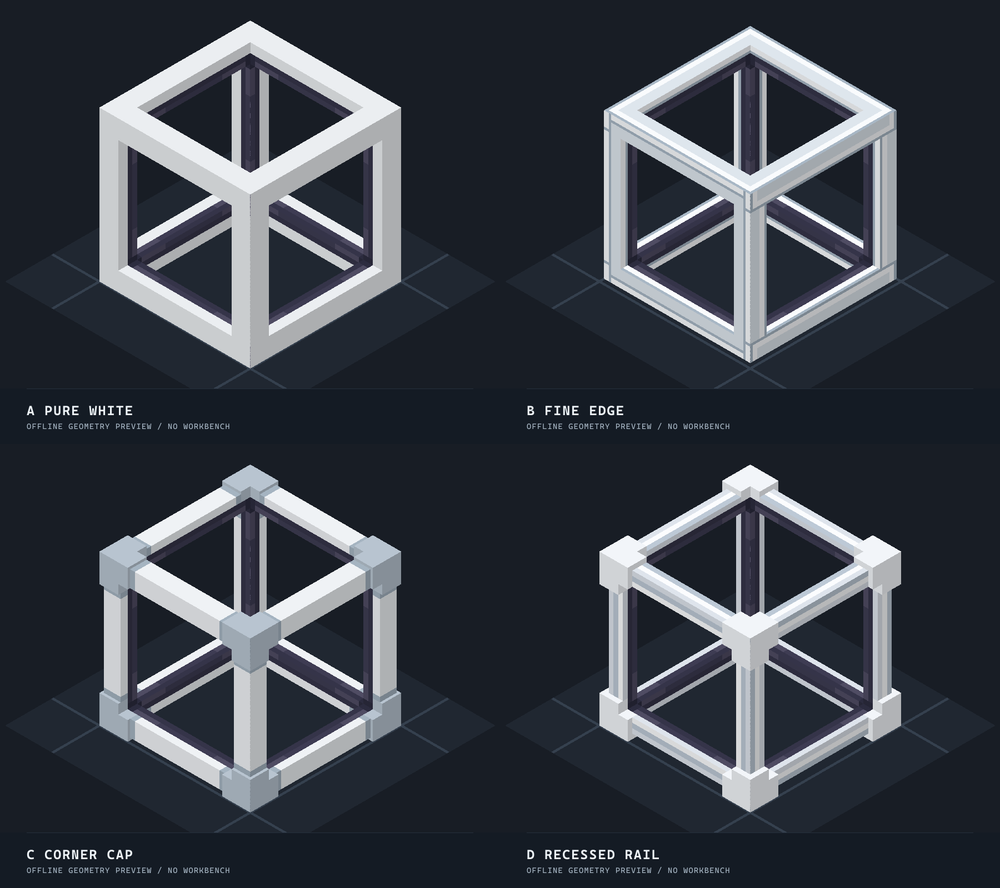

# 외부 프레임 시안



현재 게임 모델을 교체하지 않는 비교용 시안입니다. 안쪽 흑연 프레임의 좌표·UV·픽셀은 원본 그대로이며,
바깥 프레임만 수정했습니다. 작업대·회전·VFX 코드는 변경하지 않았습니다.
기존에 없앤 프레임 사이의 틈은 다시 생기지 않으며 여섯 면의 중앙은 열려 있습니다.

| 시안 | 외부 프레임 디자인 | 편집 파일 |
| --- | --- | --- |
| A · Pure White | 기존 두께의 무장식 백색 일체형 | [Blockbench](a-pure-white/tacz_assembler.bbmodel) |
| B · Fine Edge | 바깥 모서리를 0.25픽셀 줄이고 얇은 테두리만 남긴 형태 | [Blockbench](b-fine-edge/tacz_assembler.bbmodel) |
| C · Corner Cap | 매끈한 백색 몸체와 절제된 회청색 코너 캡 | [Blockbench](c-corner-cap/tacz_assembler.bbmodel) |
| D · Recessed Rail | 가운데를 0.5픽셀 낮춘 골조와 백색 코너 접합부 | [Blockbench](d-recessed-rail/tacz_assembler.bbmodel) |

각 폴더에는 독립적인 `.bbmodel`, 원본에서 만든 외부 텍스처, 게임 형식 JSON 및 미리보기가 있습니다.
외부 텍스처에는 다른 모드 에셋을 가져오지 않았습니다. 각 시안은 같은 리소스 ID를 사용하는 대안이므로
여러 시안을 동시에 게임 리소스에 복사하는 용도가 아닙니다. 게임에 적용할 시안은 아직 선택하지 않았습니다.

저장소 루트에서 생성 및 검증:

```sh
node design/assemblers/compact/generate-variants.mjs <node_modules>
node design/assemblers/compact/generate-variants.mjs <node_modules> --check
```

생성기는 원래 A 시안을 기준 형상으로 재사용하므로 현재 게임 적용 모델을 바꾸어도 A–D 시안은 유지됩니다.
미리보기 도구도 공용입니다. 분수 좌표를 포함한 모든 경계를 나눠 빈틈·부피 겹침·
열린 중앙 공간을 검사하고, 내부 모델·UV·텍스처·Blockbench 요소가 바뀌지 않았는지 확인합니다.
현재 게임용 모델·텍스처 및 원본 Blockbench·미리보기 파일 5개의 내용도 생성 전후 동일함을 검사합니다.
A/B는 44큐브, C/D는 외부 단차를 나누어 92큐브입니다.

생성/재현 검사와 미리보기의 투영·UV·가림 검사는 통과했습니다. 비교 이미지는 실제 모델을 사용한
오프라인 렌더이며 인게임 스크린샷이 아닙니다. 디자인 파일만 추가하므로 Gradle 빌드·데이터 생성·
클라이언트 실행은 재실행하지 않았습니다. Blockbench 앱 직접 열기·배포·커밋·푸시도 미실행입니다.
